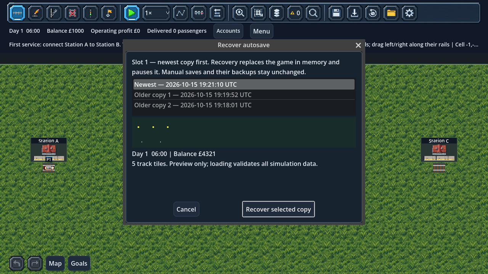

# Rotating autosaves and recovery

Autosaves are enabled by default. **Settings → Save protection** offers **Off**,
**every game hour**, **every 3 game hours**, or **every 6 game hours**. One game
hour takes about one real minute at 1×, or six seconds at 10×. Paused game time
never advances the deadline. This is game-time scheduling, not a wall-clock promise.

Each of the four manual slots has **three separate recovery copies**. The oldest
copy is replaced after a successful new write. Manual saves and their previous-save
backups are never changed by automatic saving.

## Recovering

- **Main menu:** select the game slot, then **Recover autosave…**.
- **In game:** open **Load**, select the slot, then **Recover autosave for selected slot…**.
- Select the newest or an older copy. The preview shows game time, balance and a
  map thumbnail. Press **Recover selected copy**. Recovery replaces the current
  company in memory and leaves the game paused.
- A damaged copy is rejected without changing the live company; select an older
  copy. Previews provide metadata, not a guarantee of full save validity.
- **Continue** still uses the latest readable manual save. Recovery does not
  silently promote an autosave to a manual file. Save explicitly to retain it there.

Starting a new company reuses the chosen slot's recovery roster as time advances.
Its existing manual save remains intact until you explicitly save over it.

## Safety and implementation

The simulation finishes its fixed-step batch before an autosave is considered.
Unfinished track gestures, long right-click removal, construction drafts and open
management/menu dialogs defer a due save until the next safe boundary. Changing
an interval, starting a game or successfully loading a save schedules forward from
that company's current tick. No catch-up burst occurs after loading.

Autosaves serialize the existing versioned save envelope and pending command queue.
They never drain commands, advance time, consume RNG, alter authority or add events.
There is no new save schema version. The regular atomic loader validates recovery
files before applying them, then reservations are rebuilt as usual.

Files live in the normal Godot user-data folder, alongside the manual saves:
`microrail_autosave_slot_1_copy_1.json` through
`microrail_autosave_slot_4_copy_3.json`. A generation number orders copies even
when writes share the same filesystem timestamp or a recovered game has an older
simulation tick. A temporary file is written/flushed before replacing only the
oldest recovery copy. Write/rename failures leave prior recovery files untouched,
show a warning and retry at the next configured interval, avoiding per-frame retries.
Incomplete `.tmp` files are never offered for recovery.

## Validation

`tests/test_autosaves.gd` covers cadence, safe-boundary deferral, bounded rotation,
slot isolation, unchanged manual files and simulation state, pending commands,
failed output, disabled/changed intervals, damaged copies, recovery from the Load
chooser and title screen, and identical scheduling boundaries at 30/60/120 FPS.
Run save-writing tests with an isolated `XDG_DATA_HOME`.

The focused regression run passed 313 checks across autosaves, manual slots,
game menus, new games, city saves, display settings and notification determinism.
The script warning audit passed all 91 game scripts. An OpenGL run also verified
recovery and Settings window sizing at 200% interface scale in 1280×720.
