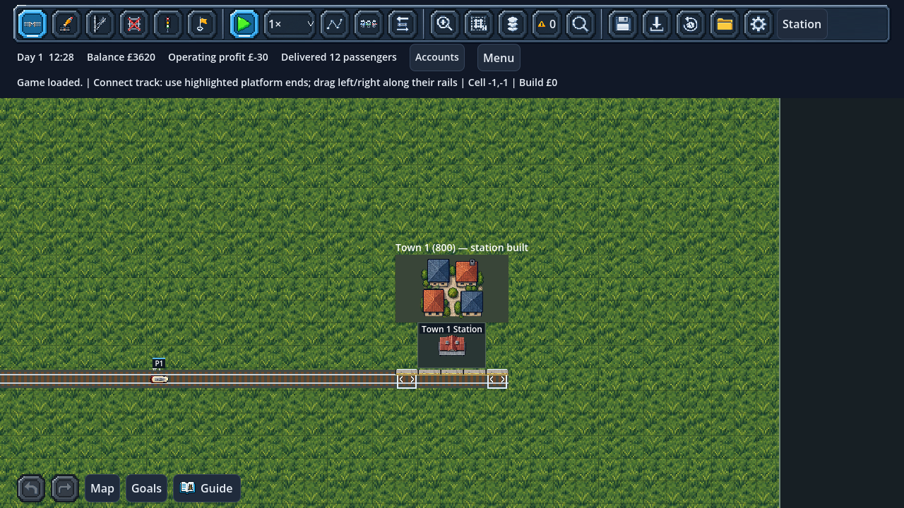
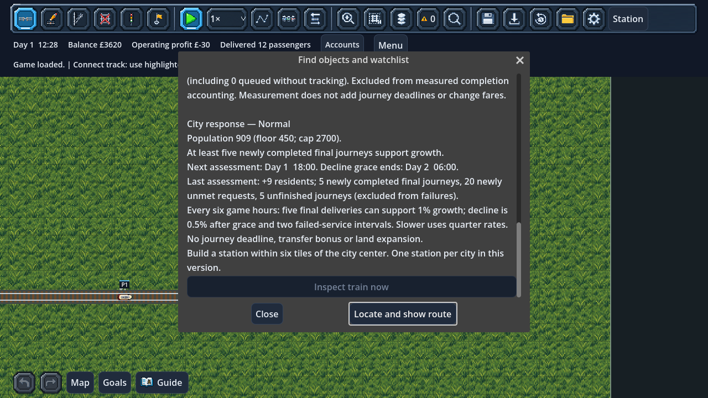

# Bounded city population response

City sandboxes now grow or decline in response to useful passenger service.
Choose **City growth** in New Game, or change **Settings → This game's city
population** during play. This is a saved company rule; it never changes another
slot or the tutorial.

- **Normal:** small population changes assessed every six game hours.
- **Slower:** one quarter of normal growth/decline, using saved fractional progress.
- **Frozen:** population stays fixed. Trains, passenger trips and finances continue.

Rules use simulation time. At 1× an assessment takes about six real minutes;
at 10×, about 36 seconds. Pausing or closing the game does not age cities.

## What earns growth

At least **five newly completed final journeys by that city's residents** since
the previous assessment support **1% growth** at Normal speed. Partial service
can help a city grow; this is not a claim that every request is satisfied.
Waiting queues, boarding, transfers and recovery never qualify as final deliveries.
A completed journey is matched to its original city request before it can count.

Each delivery is consumed by one assessment. Old totals cannot keep generating
growth. Changing the rule starts a fresh interval and clears fractional/streak
progress, so unfreezing cannot cash in deliveries accumulated while frozen.

The first rule compares newly resolved outcomes, not a misleading same-period
coverage percentage: a late delivery remains attributable to its older request,
while a rejected request is already known to be unmet. The existing journey-time
and timetable targets do not become growth deadlines.

## When decline can happen

A new or migrated company has **one game day of protection against decline**.
Positive service can support growth during that grace period.

After the full grace day, **two consecutive assessments** with newly rejected
requests, no new final deliveries, and no unfinished accepted journeys permit
**0.5% decline** at Normal speed. With uninterrupted unmet demand, the first
possible decline is at hour 36: the day of grace, then two six-hour intervals.

- Unfinished journeys hold a city stable rather than becoming failures.
- Any positive final service below the growth threshold holds it stable.
- Unknown passenger origins suspend decline conservatively.
- If request tracking reached its safety limit, population stays stable instead
  of using incomplete measurements.
- A quiet period with no newly resolved outcomes does not cause decline.

Slower uses **0.25% growth / 0.125% decline**. Integer residents and saved fractional
remainders avoid systematic rounding loss. Frozen still advances assessment
baselines without changing population, preventing later catch-up changes.

## Bounds and feedback

Each city retains its starting/migrated population as an anchor:

- **Floor:** half the anchor, rounded down, at least one resident.
- **Cap:** three times the anchor, at most 1,000,000 residents.

New ordinary cities therefore keep at least 400–750 residents and cap at 2400–4500.
Changed population feeds the existing trip-generation and destination-weighting
rules. Existing fares, loans, queue capacity, platforms and train capabilities
are unchanged; later service-quality/reputation refinements can build on this.

A short header notice names cities whose populations changed. Map labels show
population and the last nonzero assessment change. **Find → City** and the linked
station inspector explain the last result, deliveries, unmet requests, unfinished
journeys, floor/cap, next assessment and grace end. History keeps sixteen assessments.

The prepared small/town/dense artwork now represents population density. Below
80% of the anchor uses the small cluster; 80%–149% uses the town block; 150% and
above uses the dense block. All art stays **inside the existing protected city
plot**. Population changes never buy land, enlarge collision footprints, demolish
rails, move stations, edit routes or teleport trains. Geographic urban expansion,
jobs and industry-driven city growth remain later work.

## Persistence and determinism

Save **version 43** adds `city_growth`: per-game rule, anchor populations,
assessment/grace clocks, consumed outcome counters, decline streaks, fractional
remainders, reasons and bounded history. Invalid rules, population bounds, future
or inconsistent samples, and impossible counter baselines are rejected before
changing any live state.

Version 42 migration preserves population, city requests, accepted passengers,
physical trains, finances, RNG, events and commands. It starts a fresh grace and
assessment baseline at the saved clock, without awarding old completions again.
Tutorial saves get an empty city-growth model and retain their original gameplay.

Rule edits run immediately while paused or at the next fixed tick while running,
through the existing command queue. Assessments run after train arrivals in each
fixed step, in sorted city-ID order. No additional simulation RNG is consumed by
assessment or city rendering. No offline or multi-period catch-up applies.

## Validation

`tests/test_city_growth.gd` checks growth/decline thresholds, full grace, sustained
failure, floors/caps, fractional slower rates, frozen-time baselines, pending and
legacy-origin protection, incomplete measurements, JSON restoration, malformed
history/counters and artwork bounds.

`tests/test_city_growth_scene.gd` earns real completed journeys through an actual
city service, crosses an assessment at 30/60/120 FPS at 10×, checks geometry and
physical continuity, resumes a growing company after save/load, validates v42
migration, rejects damaged saves atomically, and proves queued settings and slot
isolation. The clock is arranged near an assessment boundary after real deliveries
so the test does not spend six real minutes merely waiting.

## Rendered previews

