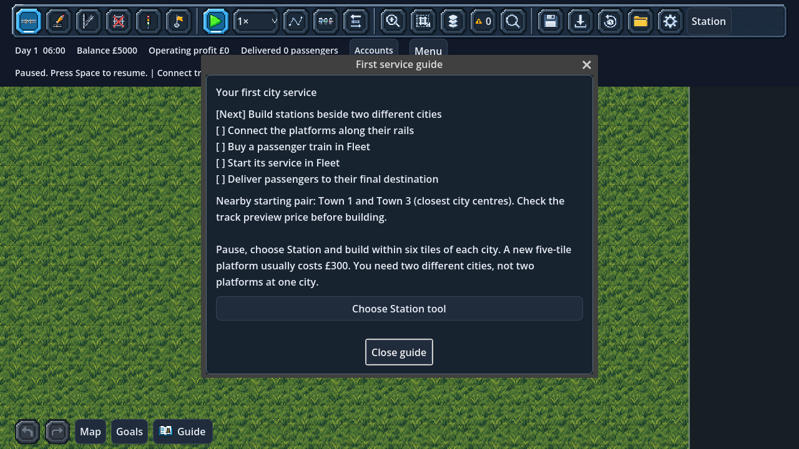

# Optional first-service guide

Click **Guide** beside Map and Goals, or choose **Menu → First service guide**.
The guide starts closed, so it never hides the first stations. Reopen it whenever
you need the next step; it reads the current company rather than storing a second
set of tutorial flags.

## City sandbox

The checklist checks:

1. Purchased stations serving two different cities.
2. A real track-graph connection between city platforms.
3. An owned passenger locomotive (a freight locomotive does not qualify).
4. An enabled passenger service with an assigned train and an intact route serving
   different cities.
5. At least one passenger delivered to their final destination.

Each step explains the corresponding existing tool and offers a button to open it.
**Choose Station tool** and **Choose Connect track** pause for construction.
**Open Fleet** opens the normal purchase/service editor; it does not buy, assign or
start anything automatically. **Resume and watch trains** starts the clock without
releasing holds, overriding signals or bypassing reservations. Click a stopped train
for its operating inspector if it does not move.

Before the first station is built, the guide compares candidate starting pairs by
a minimum budget: two £300 stations, one £400 shuttle and optimistic connecting
rail length. Rivers add £40 per water tile, so a slightly farther same-bank pair
can be cheaper. Candidate station footprints must pass placement and dry-land
checks; suggested bridge spans exclude protected city/industry footprints.

This is explicitly a **lower bound, not a route quote**. It does not find a complete
track path, reserve a crossing or guarantee affordable approaches. Curves, protected
buildings and detours can increase the actual price. Inspect Station and Connect
previews before committing. Advice reflects the current balance without spending
money or advancing the RNG. Once stations exist, the checklist uses the real live
connection and retains the simple nearby-city reference rather than quoting a new
company budget against partially built infrastructure.
New stations usually cost £300 each, and the standard passenger shuttle costs £400.
The existing £5000 city budget and all fares, costs and financing rules are unchanged.
Unfinished construction strokes prevent opening the guide. Actions refuse an
unapplied construction draft and leave it intact.

**Goals** shows the current city checklist step/progress. The full list stays in
Guide, keeping the optional map panel small. Checkmarks use text rather than colour
alone. A prepared first-service icon is used beside the Guide label.

## Tutorial

The original starter train is already supplied. Its guide has only the existing
A–B connection and first delivery steps. Connect the rails and resume; the tutorial
still starts its train automatically and pays its existing objective rewards.

## First delivery and persistence

The first actual final arrival displays a header message with passenger count,
destination and actual fare received. Waiting passengers, boarding and intermediate
stops/transfers cannot trigger it. The completed total remains visible when you
reopen the guide; it gives no extra reward and never credits another fare.

The guide pauses time and running costs while you read. Close restores the prior
pause choice and keeps your speed. Its explicit construction/Fleet/Resume actions
choose pause as described above. The window blocks
map shortcuts while open, uses scrolling, and fits 1280×720 at 200% interface scale.

Readiness checks reflect the current layout and can regress after track damage or
service withdrawal. The first-delivery fact is the company's saved final-delivery
counter. Loading reconstructs the checklist without replaying the arrival message.
No new save schema, command, simulation RNG draw or event type is introduced.
Read-only checks refresh at most four times per real second while Guide or Goals
is visible; opening either refreshes immediately.

## Validation

`tests/test_first_service.gd` builds a real generated-city link, buys/starts a train
through the normal APIs and runs it until passengers arrive. It checks truthful
steps, freight exclusion, broken/repaired connectivity, waiting/boarding versus
final delivery, one-time feedback, save/load reconstruction, absence of extra
rewards, intact drafts/gestures, tutorial flow, menu handoff and larger UI scaling.
Run save-writing tests with an isolated `XDG_DATA_HOME`.

Focused regression: **388 checks passed** across nine suites (guide, opening
session, game menu, display settings, autosaves, city saves, fares, journey timing
and notification determinism). The warning audit passed all **93 game scripts**.
The guide was also rendered at 100% and 200% scale in 1280×720.
