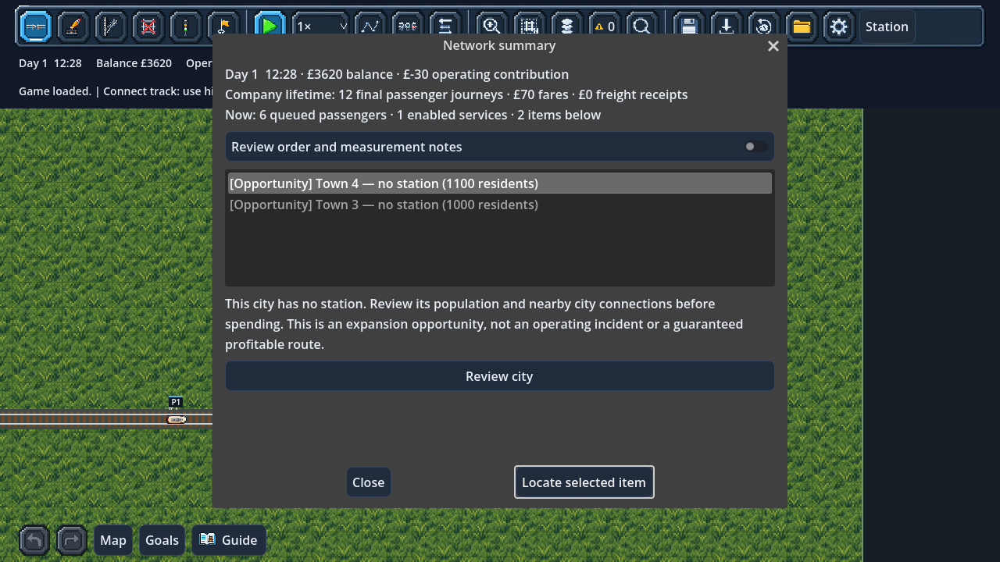

# Actionable network summary

Open **Accounts → Network summary**, or **Find → Service performance cards →
Network summary**. It pauses the game and takes a fresh snapshot. Close it and
resume when ready. Reopening refreshes the evidence; it is not an incident history,
forecast or automatic dispatcher.

The headline separates company-lifetime final passenger journeys and receipts
from current station queues and enabled services. Operating contribution means
passenger fares plus freight receipts minus train running costs. It excludes
capital purchases, construction, rewards, loan flows and interest. Enabled does
not mean moving: dwell, holds, schedules and reservations can stop a service.

Expand **Review order and measurement notes** for the ranking rules and financial
definitions. They start collapsed to keep the review list visible at large UI scales.

## Review order

1. Confirmed deadlocks.
2. Incomplete routes and overdue loan payments.
3. Continuous measured traffic waits of at least **five simulation seconds**.
   Longer waits lead within this category. Dwell and deliberate holds are excluded.
4. Accepted passengers waiting at a station with no outward connection in the
   current enabled, unheld, physically complete passenger service graph.
5. Connected stations at **80% or more** of waiting capacity, ordered by fill.
6. Recent measured left-behind boarding opportunities, ordered by count.
7. Intentional dispatcher holds, explicitly labelled as information.
8. Cities without a station, explicitly labelled as expansion opportunities,
   ordered by current population.

Equal priority and equal measurement use stable object keys, making the list
repeatable regardless of collection insertion order. This ordering is a review
rule, not a company quality score or a recommendation to prioritise expansion
above an operational failure.

Each item states its evidence and provides an action:

- Train problems open the existing operating inspector, with the current waiting
  cause and physical recovery controls.
- Station advice locates the station and opens its actual queue/amenity inspector.
- Capacity evidence opens that train's service performance card.
- Overdue payments open Bank loans; they have no fabricated map location.
- City opportunities select the exact city report in Find.
- **Locate selected item** moves the camera where an item has a map location.

An acknowledged issue remains visible and marked until its cause clears. Routine
waits below five seconds remain available in Problems and individual inspectors.
No matching items means no evidence meets these rules, not a safety guarantee.

## Measurement limits

A station without an enabled connection may have an intentional hold, incomplete
track, a disabled service or no route yet. Existing accepted passengers stay
queued; they are not declared failed. Check the station and Routes/Fleet before
changing the network.

Left-behind evidence filters the latest 128 company-wide boarding opportunities
to the currently assigned vehicle, including its earlier assignments. A person
can be counted repeatedly. It does not prove the train is full now and resets on
load, as do traffic-wait diagnostics. The entry says this explicitly. Neither a
larger waiting area nor a capacity purchase is promised to solve the underlying
route or frequency issue.

Cities without stations are opportunities, not startup warnings or guaranteed
profitable investments. Their ranking does not estimate connection cost or ROI.
The existing first-service guide still suggests a feasible initial connection.

## State and roadmap

The summary derives from existing authority diagnostics, queues, service graphs,
capacity samples, finances and city populations. It writes no gameplay state,
uses no RNG, moves no trains and creates no events or commands. Opening it does
not acknowledge alerts, place infrastructure, reverse trains or buy upgrades.
Only its explicit review/locate actions change presentation and selection.

The summary itself introduced **no save-version change** (version 44). The later
[company progress reports](PROGRESS_REPORTS.md) use version 45. Summary
rows are recomputed; each slot retains its own existing measurements and pins.
Saved periodic company reports and equal-length historical comparisons are now
available through **Progress reports**. Current summary rows still derive live
evidence rather than historical issues.

`tests/test_network_summary.gd` covers thresholds, deterministic ordering,
unchanged input/full-save snapshots, empty starts, each review action, camera-only
location, Accounts integration, tool reset and 200% layout. Existing Problems,
notifications, service-card, object-search, stage UI and game-menu suites remain
active.

