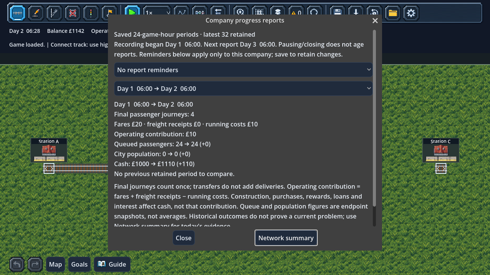

# Saved company progress reports

Open **Accounts → Progress reports**, or use **Progress reports** in the Network
summary. Reading pauses the game. Select a completed period to review it; close
and resume when ready. **Network summary** returns to current actionable evidence.

A report records every **24 game hours from this company's recording baseline**,
not necessarily at midnight. That takes about 24 real minutes at 1× or 2 minutes
24 seconds at 10×. Pausing and closing the game do not age reports. The window
shows the recording start and next report clock.

## What is recorded

Each period contains:

- Final passenger journeys completed, counted once at the final destination.
- Actual passenger fares, freight receipts and train running costs.
- Operating contribution: fares + freight receipts − running costs.
- Queue, city population and cash at the start/end of the period, with changes.

Queue and population values are endpoint snapshots, not averages. Cash includes
construction, purchases, rewards, borrowing, repayments and interest; operating
contribution excludes these items. Transfers do not multiply final journeys.
Reports cover the whole company, including outcomes from services later removed.
They do not estimate profitability or invent a score for service quality.

The report compares final journeys and operating contribution with the previous
retained **equal-length** period using absolute differences. A first report has
no previous trend. Different durations are not compared. **Recent period
comparison** expands a compact history of the latest eight periods; the selector
retains up to **32** full reports. Older reports are discarded in order.

## Optional reminders

The reminder dropdown belongs to the current saved company:

- **No report reminders** is the default. Recording continues quietly.
- **Notice when a report is ready** adds a short message; simulation continues.
- **Notice and pause when ready** adds the message and pauses after the fixed tick.

Reports never open themselves. Save after changing the preference to retain it.
Changing reminders does not reset the recording baseline or discard history.
While paused, a preference applies immediately; while running, it uses the
existing fixed-tick command queue. Existing incident notifications are flushed
after report reminders, so incident messages retain priority. Loading another
slot restores its own preference and report history.

## Save format and limits

Save version **45** persists the baseline, reminder mode and bounded snapshots.
Version 44 migration records current company values at the saved clock and starts
with no earlier reports, because historical per-period figures cannot be inferred
from cumulative totals. Existing passengers, physical train positions, finances,
RNG, event log, commands, city growth, service counters and watchlists are preserved.
Normal saves, backups and autosaves all include the current recording state.

Recording runs at the end of fixed simulation steps after arrivals, costs, city
response and loan payments. There is no wall-clock sampling or offline catch-up.
An exceptional development clock jump produces one explicitly longer period,
without fabricated intermediate periods or an unequal-duration trend.

Save validation checks finite integer snapshots, monotonic cumulative counters,
period ordering, matching neighbouring endpoints, the retained-history limit,
baseline consistency and counters bounded by the live company totals. Damaged
reports are rejected before changing the live game.

These are company period summaries, not detailed route histories or incident
replays. Existing service cards and Network summary remain the tools for route
attribution and current causes. Richer graphs can build on this history later;
focused scenarios/goals are the next development priority.

## Validation

`test_progress_reports.gd` checks period thresholds, no duplicate reports,
operating/cash separation, equal-duration comparisons, bounded retention, JSON,
damaged history, genuine simulation/saving, 30/60/120 FPS at 10×, fixed-tick
preferences, optional pauses, slot isolation, migration and 200% UI layout.
The city growth deterministic snapshot also includes the report baseline/history.
Existing service-card, city, migration, autosave, network-summary, save-slot,
game-menu and stage UI suites remain active.

