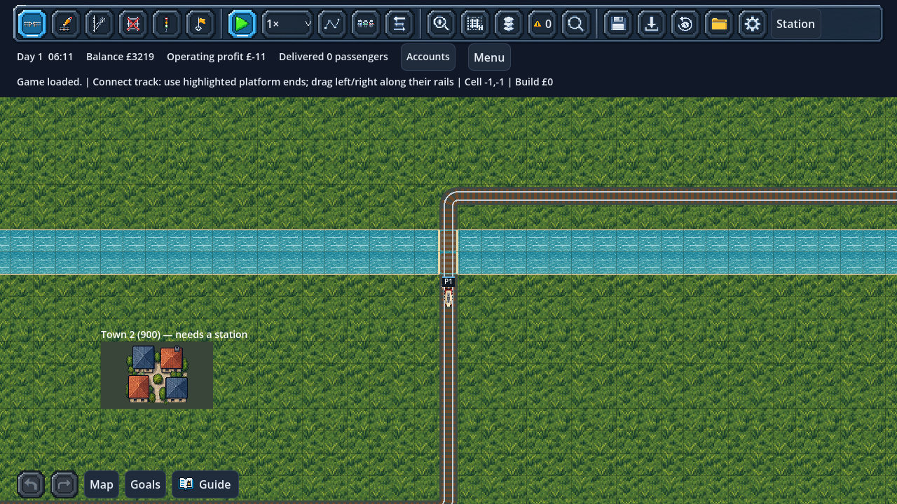

# First river maps and bridge crossings

Choose **New Game → City sandbox → Terrain: River with bridge crossings**.
Flat land remains the default. Tutorial and the original two seeded scenarios
remain flat; Across the River selects its river preset automatically. Terrain is a saved company choice; changing cosmetic grass/autumn/snow does
not change water or construction permissions.

This first immutable profile, `river_v1`, has a two-tile-wide east–west river
across **rows 17 and 18** of the 80×50 map. City and industry placement remains
seeded. This is a first crossing puzzle, not a meandering-river generator or an
elevation system. The Network map also marks the river.

## Build a crossing

Use the ordinary Connect or Draw track tool:

1. Approach the river on dry land.
2. Start on dry land at **row 15** and drag straight north–south to **row 21**,
   leaving approach track on both sides. The minimum bridge footprint is rows
   **16–19**: two water tiles and one straight dry bank tile on each side. Turns must be outside the four span tiles.
3. Release when the preview is valid. The two water rails become the bridge deck
   automatically; there is no separate bridge purchase/tool.

The deck costs **£50 per water tile** (£10 rail + £40 bridge), with ordinary
**£10 bank tiles**. A bare four-tile crossing costs **£120**. The actual build,
draft quote, affordability check and history use these prices. Copy/paste and
blueprint drafts pass through the same terrain validation and pricing.

The first bridge supports ordinary reservations and whole-train occupancy through
the existing movement graph. Trains use the same rails and authority rules as
elsewhere. There is no visual-only shortcut, new pathfinder, independent bridge
simulation or elevated crossing layer.

## Construction rules

- Both water tiles and both straight bank tiles must exist together. Partial
  construction, curves, diagonal crossings, junctions and crossing tracks on the
  span are rejected before any track or money changes.
- Signals go on **dry banks**, not over water. Waypoints remain route directives.
- Stations/buildings/platforms need dry land and cannot replace a supporting bank
  of an existing bridge. A dry bank without a bridge can be used where ordinary
  station placement rules permit; its protected platform then prevents a bridge
  being built through it.
- To remove a bridge, right-drag across **both water deck tiles together**. A
  single-tile removal or removal of a bank beneath a surviving deck is refused.
  Water tiles refund **£25 each**; dry rail refunds remain £5.
- Existing reservation checks prevent demolition or geometry changes under a
  train. If some selected deck tiles cannot be removed, the whole crossing edit
  is refused rather than leaving a broken span. Undo/redo preserves whole spans
  and their exact cash changes.

Track elsewhere retains the existing stop-in-place behaviour when edited. The
special span rule applies to bridge structural integrity. Demolition safety and
water restrictions also apply to draft plans, switches, signals and undo/redo.

## Artwork and accessibility

The river uses the uploaded `water_shallow` material. Decks, railings, shorelines
and water-line marks make crossings readable; high-contrast mode retains these
shape cues. This is static water, without currents, boats, flood events or frozen
river mechanics. Winter cosmetic ground does not make water buildable.

## Saves and scope

Save version **47** adds an immutable terrain-profile ID. The `river_v1` geometry
is defined by that versioned ID; future layouts must use a new profile rather
than reinterpret saved maps. Bridge rails are saved in the ordinary authoritative
track graph and validated as complete spans on load. No decorative sprite can
create a usable crossing.

Version 46 migration uses **flat** terrain: it adds no water, deletes no existing
track and changes no positions, passengers, finances, RNG, goals or commands.
Terrain profiles, station footprints, deck geometry, signals and bank integrity
are validated before live state changes. Scenario presets validate their required terrain; the original two require flat
land and Across the River requires its original river profile. Normal slot/backups/autosave rules remain active.

[Wide/meandering presets and crossing guidance](RIVER_VARIETY.md) are now implemented.
Terrain-aware first-service connection suggestions and their optional map preview are implemented. Elevation, tunnels, boats and weather
physics remain later systems.

## Validation

`test_river_bridges.gd` covers partial/angled spans, bank protection, signals,
actual pricing/refunds, affordability, graph connectivity, undo/redo, saving,
damaged saves and migration. It builds a cross-bank passenger service, runs a
physical train over the bridge, attempts demolition under its reservations and
saves/loads the resulting service. Existing construction, planning, blueprint,
mouse, city, scenario, report and game-menu suites remain active.

## Inspect a crossing and its costs

Choose **Inspect** (default **I**) and click a bridge tile, either bank, or water
where you might build a crossing. Trains and station information retain priority
when clicking their existing footprints. The bridge dialog highlights the span
with outlines and diagonal marks, pauses the game and reports:

- Required bank coordinates and water/bank tile counts.
- Full new-span rail price and bridge surcharge separately.
- Missing tile coordinates and their material cost, plus incompatible existing rails.
- Existing water-deck refund value; dry bank rails have a separate £5 value each.
- Current tile-reservation train IDs, without calling these physical occupancy or
  block authority.

These are read-only values for the span, not an editing permission or a guaranteed
refund. Approach rails are extra. Construction rechecks funds, signals, protected
land and current claims. All water tiles must be removed together and supporting
banks retained until the deck is gone. Close/Escape restores the previous pause
choice. Loading clears the old inspection instead of retaining stale facts.

The construction hint also shows the water-rail subtotal (£50 each) alongside
its £40-per-tile surcharge, so that base rails are not mistaken for an extra
unquoted charge. Nothing in this feature changes prices, safety rules or saves.
