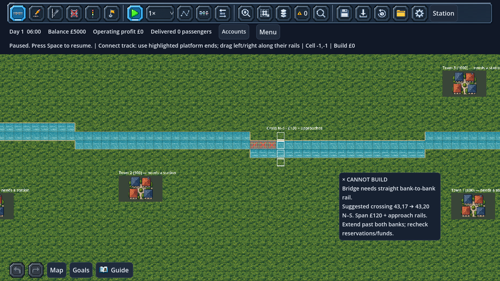
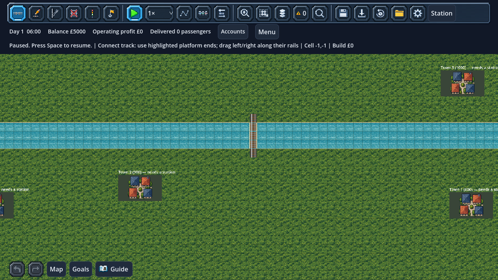

# River variety and crossing guidance

New city sandboxes now offer four terrain presets:

| Terrain | Water | Crossing |
| --- | --- | --- |
| Flat land | None | Ordinary construction |
| River with bridge crossings | Original two-row river, rows 17–18 | Original four-tile bank-to-bank span |
| Wide river | Three water rows, 16–18 | Five-tile span, banks 15 and 19 |
| Meandering river | Connected stepped bends, varying by column | Four-tile span with locally varying bank rows |

Select the preset in **New Game → City sandbox → Terrain**. The same map seed,
city count and terrain preset reproduce the starting layout. River shapes are
immutable preset geometry in this slice, not randomly generated river paths.
City locations still depend on the seed. Existing scenario presets remain flat.

## Guided crossings

An invalid stroke touching a river now highlights a nearby feasible north–south
crossing with white cell outlines and a map label. The pointer hint gives both
bank coordinates and the quoted span cost. Extend the drag past both banks;
approach rails are additional work and cost. The guidance does not redirect your
stroke or place track automatically.

Suggestions examine columns nearest the cursor, with the western column breaking
a distance tie. They skip protected buildings/platforms, reserved tiles,
incompatible existing track and water signals. Complete existing crossings can
be reused for no new span cost. If no feasible column exists, no crossing is
invented. Availability and money still need rechecking when you build; the
suggestion neither reserves track nor guarantees an affordable complete route.

Successful construction hints now separate ordinary rail/switch prices from the
**£40-per-water-tile bridge surcharge**, matching the actual transaction quote.
A new two-water-tile span costs £120 including two new bank tiles. A three-water-
tile span costs £170. Existing compatible rails reduce the new construction cost.
All amounts exclude additional approach track.

Removal hints use the actual **£25 water-tile refund** and explicitly warn when
the selected deck is incomplete. Remove all water tiles together and keep banks
until the deck is gone. Reservations and whole-span validation still govern edits.

## Profiles and compatibility

Save version **48** recognises `wide_river_v1` and `meander_v1` alongside `flat`
and the original `river_v1`. Version 47 migration preserves the original terrain
profile and all company state exactly. It adds no bends or width changes to a
loaded world. The original river remains at precisely the same coordinates.

Rendering, shorelines, the Network map, protected station footprints, bridge
geometry and save validation query the same terrain mask/span methods. Bridge
rails continue to use ordinary movement/reservation graph rules. This update
adds no elevation, tunnels, boats, currents, flood or winter-ice mechanics.

The next useful step is terrain-aware first-service planning: a suggested initial
connection should account for bridge prices and protected approaches. More
procedural terrain variety can follow once those suggestions are reliable.

## Validation

`test_river_variety.gd` checks connected water masks, dry city plots over several
seeds, span geometry/pricing, stable nearest-column choices, reserved/protected
exclusions, zero-cost reuse, read-only advice, cursor explanations, removal
warnings and exact profile save/load/migration. Original bridge movement,
reservation protection, construction hints, drafts, blueprints and city/report
regressions remain active.

