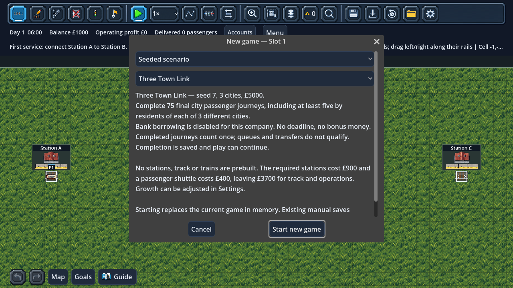

# First seeded scenarios

Choose **New Game → Seeded scenario**, select a preset and read its briefing.
Starting replaces the in-memory game; manual saves change only when you Save.
Existing autosave/recovery rules still apply. Preset seed/city count are fixed;
the ordinary City sandbox keeps its editable seed, random button and city count.

| Preset | Starting world | Final-journey goal | Resident origins served | Restriction |
| --- | --- | --- | --- | --- |
| First Connection | Seed 42, 3 cities, £5000 | 40 | At least 5 final resident journeys from each of 2 cities | Ordinary bank loans allowed |
| Across the River | Seed 42, 3 cities, £5000, River preset | 40 final cross-river journeys by Town 3 residents | At least 5 resident journeys from one other city | Ordinary bank loans allowed |
| Three Town Link | Seed 7, 3 cities, £5000 | 75 | At least 5 final resident journeys from each of all 3 cities | No bank borrowing for this company |

These are short introductory challenges with **no deadline**, extra completion
money, hidden penalties, medals or leaderboard. All start empty: build stations,
connect rails, buy a locomotive and start a service. The optional Guide remains
available. Initial growth is Normal and can be adjusted in Settings; that choice
is not a ranked difficulty rule in this first slice.

## Goals and useful service

The **Goals** panel opens initially for a new scenario and replaces the ordinary
first-service summary with both required counters. It can still be hidden with
Goals/G. The delivery bar covers the volume target; the second line separately
shows how many resident origins have met their five-completion minimum. Filling
the bar alone does not win if too few cities have been served.

Completions use the existing city request measurements, attributed to original
resident cities and counted only at final destinations. Boarding, queues,
interchanges, train purchases and station count alone do not qualify. A high
volume from one city cannot replace useful service for the other required cities.
There is no requirement for a particular train, route shape or platform design.

When both conditions are met, completion is recorded once at a fixed simulation
tick, a notice/event is emitted and Goals shows **SCENARIO COMPLETE**. Ordinary
fares continue; there is no completion cash award or repeated reward. Keep
playing or start another company. Three Town Link's no-borrowing rule remains
active after completion. It is enforced in the borrowing backend as well as the
disabled Bank buttons and their explanatory tooltips.

## Saves and scope

Save version **46** retains scenario identity and its completion tick. Progress
comes from the company's existing saved final city-journey measurements, without
a second set of delivery counters. Version 45 migration leaves older companies
as ordinary sandbox/tutorial games; it does not infer a scenario from a matching
seed or award old achievements.

Validation checks supported identities, preset world seed/city count, completion
bounds, actual goal measurements for claimed completion and zero lifetime bank
borrowing for Three Town Link. Load preserves physical positions, passengers,
RNG, commands, finances, city growth, watchlists and reports. Slots/backups and
autosaves retain their own scenario state.

The first scenarios validate a complete loop of selecting a reproducible start,
funding a feasible railway, moving real people and saving a clear outcome.
Timed objectives, challenge modifiers, scoring/medals, scenario editing and cargo
challenges remain extensions. Rivers and bridges now have a focused passenger scenario; broader scenario packs
can use this foundation later.

## Validation

`test_seeded_challenges.gd` builds actual stations and routes within the £5000
budget for both presets. It runs generated passengers through physical trains to
complete the goals, checks the multi-city requirements, rule enforcement, no
repeat awards, exact save/load and old-save defaults. New-game, loan, report,
city, service-card, autosave, slot and game-menu regressions remain active.

## Across the River

Select **New Game → Seeded scenario → Across the River**. The seed, three cities
and original two-row river preset are fixed. Town 3 is the only north-bank city;
its station catchment cannot reach the south bank. Every matched final journey by
its residents to another city therefore crosses the river. Goals counts **40 Town 3
resident final journeys**, plus five final resident journeys from at least one
other city. High volume between only the two southern cities cannot win.

Start with £5000 and no infrastructure. The briefing checks a complete affordable
Town 3–Town 1 construction witness (including platforms, bridge rails and shuttle).
Open **Guide → Preview suggested connection on map** for a dashed proposed layout.
Build both dry banks and every water tile as straight north–south bridge track;
leave and enter platforms horizontally. Bank loans remain available; there is no
deadline or completion bonus. Growth rules remain adjustable.

The preset uses the existing scenario identity, completion tick and city resident
measurements, with no new saved counters or save-format change (current version 51, which also retains priorities, optional freight contracts and reminder markers).
Older companies and the original two scenarios retain their goals. An older build
that does not know this new scenario identity will reject its saves as incompatible.
Loading checks the required river profile and original city geometry as well as
qualified completion totals, preserving the cross-river inference.

`test_river_challenge.gd` purchases stations, lays the checked bridge through the
ordinary construction backend, buys/starts a shuttle, matches the quoted budget,
runs generated passengers to completion and checks unfinished/completed save-load,
terrain/geometry rejection and automatic terrain selection in the chooser.
