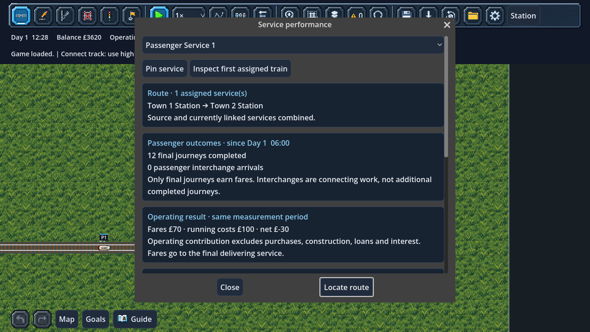

# Service performance cards and saved watchlists

Open **Find → Service performance cards**. Select a service in Find first to
open its card directly, or use the card's route dropdown. Linked services share
a source card; independent services remain separate. The game pauses while you
read. Close and resume when ready.

The cards show:

- **Passenger outcomes:** final journeys completed and passenger interchange
  arrivals, counted separately. A transfer is useful connecting work, but is not
  another completed origin-to-destination journey. Queues, boarding, through
  stops and unfinished recovery do not earn a completion.
- **Operating contribution:** actual fares minus actual charged running costs.
  Fares belong to the last delivering service; feeder routes receive no share.
  This excludes purchases, construction, loans and interest, so a feeder can
  show a negative contribution while helping the whole network.
- **Assigned vehicles:** current operating status, continuous traffic waiting
  and recent traffic waiting. Inspect the first assigned train for its blocking
  cause or locate/highlight the route. Dwell and deliberate holds are excluded
  from traffic waiting.
- **Capacity:** seat-time-weighted utilisation and full train-time over the last
  approximately 120 simulation seconds, plus eligible passengers left behind
  across the latest 128 boarding opportunities company-wide, filtered to the
  currently assigned vehicles. Repeated opportunities can count the same person
  again; this is not a unique-passenger denial count.
- **Arrival targets:** on-time counts, positive lateness and running time from
  the latest 128 targeted trips company-wide, filtered to current member service
  identities. A route without targets has no punctuality measurement.

**Measurement details** expands the attribution and history notes. The first
cards keep the headline outcomes and money visible without opening those notes.
Capacity and waiting diagnostics reset on load and may include earlier assignments
of the same vehicles. Arrival history is saved and may include earlier route
configurations. Source/linked membership reflects the current grouping.

Freight has a separate card with actual terminal cargo totals and lifetime
freight receipts/costs. Intermediate processing deliveries are not extra terminal
sales. The first version still supports one freight service.

## Saved measurements

Save version **44** adds passenger service counters and a company watchlist.
Counters persist across loads, renaming, route edits and train replacement.
Removing a service removes its row; starting a new service begins at zero. A new
company starts its measurement at Day 1 06:00. Version 43 migration starts at the
saved clock, with empty route counters: existing company income and delivery
history cannot honestly be assigned retrospectively to routes.

Migration leaves all existing finances, physical positions, passengers, RNG,
events, commands and city growth unchanged. Invalid references, fractional or
negative counters, impossible receipts, counters exceeding company totals and
future baselines are rejected before any live state changes.

## Watchlists

**Pin service** on a card or **Pin selected** in Find saves a stable object key
with that company. **Pinned only** in Find displays the watchlist. Train, service,
station, city and active industry pins survive renaming and save/load. Each slot,
backup and autosave carries its own list. Save after editing pins to retain them.
New games start empty; loading another company replaces the list instead of
merging it with the current session.

Missing/sold/removed objects are pruned when Find refreshes or the game is saved.
Removing a service immediately clears its service pin so redeploying a locomotive
does not silently reuse the previous route's pin. Stored vehicles remain pinnable
and have no map location. Up to 128 objects may be pinned. Unknown object keys or
invalid pin values in a save are rejected.

This batch does not add historical graphs, a composite company score or periodic
reports. The [actionable network summary](NETWORK_SUMMARY.md) is now available from Accounts
or the service-card actions. Optional progress reports remain the next step.

## Validation

`test_service_performance.gd` exercises real primary/additional-service deliveries
and costs, transfer/final distinctions, linked aggregation, weighted capacity,
exact save/load, slot isolation, old-save baselines, damaged-save rejection,
read-only map controls and 200% UI layout. The city growth scene test includes
service counters in its 30/60/120 FPS comparisons at 10× speed. Existing object
search, save slots, city saves, legacy migrations, revenue, linked services,
autosaves, new-game and game-menu checks remain active.

