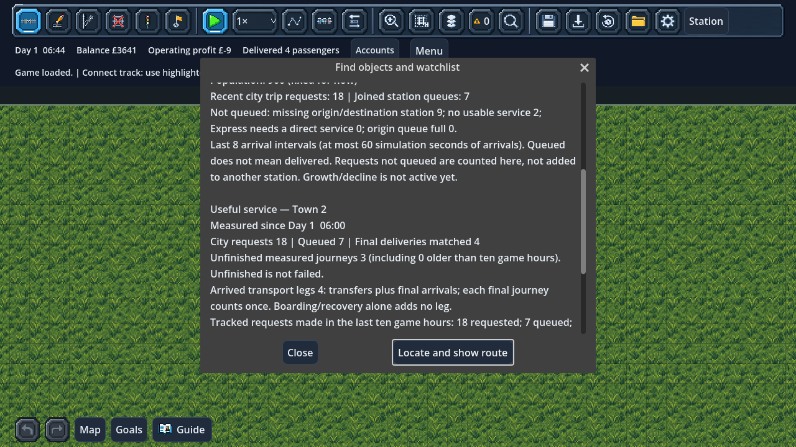

# Useful city service: requests through final delivery

Open **Find → City**, or click a city station and scroll down its inspector.
Below the existing population/queue report, **Useful service** shows:

- Requests and admissions since measurement began.
- Final deliveries matched to those requests.
- Unfinished accepted journeys, including older ones still waiting or travelling.
- Completed transport legs: an interchange ends one leg, and the final arrival
  ends another. Boarding and returning unfinished passengers during recovery do
  not count as delivered transport.
- Requests made in the last **ten game hours**, with their own completed/pending
  counts. A late delivery updates its original request group, not today's demand.
- Separate unmet reasons: missing station, no usable service, Express requiring
  a direct leg, and a full origin queue.

Population, fares, service eligibility, financial rules and train movement are
unchanged. **This is measurement, not an active growth or satisfaction score.**
No accepted passenger becomes a failure just because time passes or a route is
withdrawn. Transfers cannot multiply final deliveries.

## Identity and accounting

A cohort groups one city's requests from one generation tick. Each admitted group
retains the original departure station, request tick, final destination and
Local/Express class. These are existing passenger identities; no second random
stream, generated passenger identifier or alternate routing system is introduced.

The city generator reports what it actually admitted/rejected after the existing
amenity/response modifiers. The observer never rerolls a destination or creates a
passenger. Queues, manifests and the journey ledger remain authoritative.

A final arrival credits the original cohort. A physical interchange records an
arrived leg while keeping the final journey pending. Reboarding and reversal/
recovery preserve the original identity and do not grant a delivery or leg.
Staying aboard through intermediate stops does not create extra transfer legs.

For tracked requests, accepted = final deliveries + still unfinished. All requests
also reconcile across accepted and the four unmet reasons. Reports show counts,
not a misleading completion percentage that treats long journeys as failures.
These are actual generated requests, not a claim to measure every potential trip
in the population. Future growth still needs fair scoring, grace periods and caps.

## History bounds

Resolved/unmet cohorts older than ten game hours are aggregated into cumulative
counters. **Older unfinished cohorts remain** until their passengers arrive; they
are not expired or silently scored as failures. Their eventual final deliveries
remain attributable even after recent history and the separate journey-time
sample list have rolled over.

A defensive limit of **4096 retained cohorts per city** bounds storage. If reached,
new requests still happen normally. Their aggregate outcomes remain recorded;
requests omitted from cohort history and their untracked admissions are explicitly
reported. Those admissions are excluded from measured pending/completion totals.
Their later final arrivals are shown as untracked. Future growth must account for
this limit rather than interpreting incomplete measurements as poor service.

The older city supply audit still shows its last twelve arrival intervals. That
short audit and the ten-hour request-cohort report deliberately have different
windows, both labelled in the inspector.

## Save version 42

The `city_service` field stores cohort identities, counters, cumulative retired
history, the baseline tick and per-city chronology. Loading validates whole
numbers, city/station ownership, unique groups/ticks, conservation and company
final-delivery bounds before changing the live game. Outstanding measured counts
must have exactly corresponding passenger counts in saved queues or onboard journey manifests;
phantom pending passengers cannot load.

Version 41 saves migrate to an empty measurement baseline at their saved game time.
Population/request history, accepted passengers, physical train positions, fares,
loans, RNG, events and queued commands remain untouched. Pre-baseline passengers
can still finish and earn their ordinary fares; they are reported as older/untracked
arrivals, never credited to newly measured demand. Journeys without a known city
origin remain in company journey totals and cannot become city successes/failures.
Tutorial companies retain their
existing station-based demand and an empty city-service ledger.

## Validation

`tests/test_city_service.gd` covers partial loads, a real two-service transfer,
reboarding/recovery, late final attribution, history retention/retirement, missing
stations/services, direct-Express refusal, queue capacity, measurement saturation,
JSON restoration, passenger-identity reconciliation and malformed records. Comparing
observed and unobserved generators proves identical demand, queues and seeded RNG.

`tests/test_city_demand_scene.gd` builds and runs a generated-city railway, checks
real completion hooks and inspector output, rejects invalid cohort saves atomically,
verifies v40/v41 migrations, and compares uninterrupted versus restored state and
30/60/120 FPS runs including the new measurements. Use an isolated `XDG_DATA_HOME`
when running save-writing tests.

Focused regression: **413 checks passed across eleven suites**, including manual
and rotating saves, generated companies, transfers, fixed-step/frame-rate
continuation and the first-service guide. The warning audit passed **94 scripts**.
The live report was also inspected using an OpenGL render.
